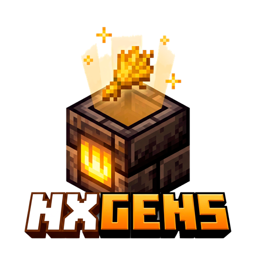

  

# NXGens

**NXGens** es un plugin de generadores y colectores de chunks para Minecraft, pensado para servidores de economía tipo prison, skyblock y gens. Combina generadores por tier con producción automática, chunk collectors virtuales con auto-venta, sellwands, multipliers por rango y un editor visual de generadores — todo configurable desde el juego.

---

## ¿Para qué sirve?

Si tu servidor quiere una economía alrededor de granjas activas donde los jugadores compran y colocan generadores de distintos tiers, farmean los drops en colectores de chunk, los venden con multipliers por rango y compiten por los mejores slots, NXGens te entrega el sistema completo como plugin drop-in, listo para arrancar y administrar desde el juego.

---

## ¿Qué puedes hacer con NXGens?

- **Generadores por tier** con producción automática, demoras por tier, hologramas y shop en inventario (GUI) con precios por generador.
- **Chunk Collectors**: colocación de colectores que juntan los drops de todos los generadores dentro de un rango de chunks (3×3 por defecto), con **auto-venta programada**, almacenamiento virtual y **sistema de mejoras** (capacidad, rango de chunks y multiplicador de venta).
- **Vender con ventaja de rango**: `/selldrops` y el uso de **sellwands** aplican el multiplier del rango del jugador (LuckPerms) sobre el precio.
- **Editor visual de generadores** (GUI): crear, duplicar, editar y probar generadores sin tocar archivos, con exportación e importación.
- **Rendimiento por slots**: límite de generadores por jugador (configurable por rango) y límite de colectores por permisos.
- **Eventos aleatorios**: eventos del servidor configurables que multiplican ventas/aparición de generadores (anunciados en broadcast) con intervalos configurables.
- **Generadores corruptos**: un motor de malfunciones aleatorias — los generadores se pueden descomponer y pedir reparación (con costo configurable) para mantener la economía viva.
- **Sistema de confianza**: dar/acceder a colectores de otros jugadores con `/gens trust`, con permisos de retiro/sales de colectores configurables.
- **Hologramas completos** sobre generadores y colectores con placeholders propios (DecentHolograms / FancyHolograms / display entities).
- **Sellwand** con glow, action bar y multipliers jerárquicos (rango del jugador × multiplier del colector).

---

## Requisitos

| Requisito | Notas |
|---|---|
| Minecraft Paper | Recomendado. Spigot puede funcionar como alternativa. Versión 1.20.x o superior |
| Java | 17 o 21 |
| Vault | Opcional pero **recomendado** — para el sistema de economía (compras, ventas, upgrades) |
| PlaceholderAPI | Opcional — habilita los placeholders `%nxgens_%` |
| LuckPerms | Opcional — multipliers y slots por rango |
| DecentHolograms / FancyHolograms | Opcional — proveedor de hologramas (usa `display` como fallback interno) |

> ⚠️ NXGens **usa un sistema de licencias**: requiere una clave de licencia en `config.yml` para funcionar (puede inyectarse automáticamente al descargar desde BuiltByBit).

---

## Contenido de esta guía

- [Instalación](instalacion.md)
- [Comandos](comandos.md)
- [Permisos](permisos.md)
- [Sistema de generadores](generadores.md)
- [Uso del GUI](gui.md)
- [Eventos y generadores corruptos](eventos.md)
- [Configuración — config.yml](configuracion/config-yml.md)
- [PlaceholderAPI](placeholders.md)
- [Preguntas frecuentes](faq.md)
